# Hi, I'm Amal John 👋

### Data Scientist · Machine Learning & Applied AI · Quantitative Risk

*PhD quantitative scientist building end-to-end ML and AI systems, from data pipelines to deployed, evaluated models.*

 

## 💫 About me

I turn large, messy data into models people can rely on. Over seven years in research I have built petabyte-scale data pipelines, trained and deployed deep learning models, and quantified risk in the tail of the distribution, where most models fail.

- 🤖 **Applied AI** — agentic LLM tools (MCP servers), retrieval-augmented generation, guardrails and evaluation
- 🧠 **Machine learning** — PyTorch, transformers, self-supervised pretraining, probabilistic and time-series forecasting
- 📉 **Quantitative risk** — VaR and Expected Shortfall, backtesting, extreme value theory, Monte Carlo simulation, model validation
- ⚙️ **Engineering** — production data pipelines, containerised APIs, CI/CD, HPC at petabyte scale

Currently a postdoctoral researcher at the Alfred Wegener Institute, where I led the development of the kilometre-scale storyline simulations for the EU's Destination Earth digital twin.

 

## 🚀 Featured projects

| Project | What it is | Stack |
| --- | --- | --- |
| [**Tail-Risk-Toolkit**](https://github.com/John-Amal/Tail-Risk-Toolkit) | MCP server giving an LLM agent market-risk tools (VaR, Expected Shortfall, Kupiec/Christoffersen backtests, EVT) plus a RAG knowledge base with hybrid search and a relevance guardrail | Python, MCP, BM25, sentence-transformers |
| [**cirrus**](https://github.com/John-Amal/cirrus) | Small foundation model built end to end: transformer with self-supervised pretraining, benchmarked training objectives, exported to ONNX and served as a live API | PyTorch, Hugging Face Hub, FastAPI, Docker |
| [**catagg**](https://github.com/John-Amal/catagg) | Monte Carlo risk aggregation engine: exceedance curves, TVaR and layered risk-transfer structures, with standard errors validated by replication (in development) | Python, NumPy, SciPy |
| [**alpine-flood-lstm**](https://github.com/John-Amal/alpine-flood-lstm) | Regional LSTM forecasting model evaluated out of sample on fully held-out units, including tail quantiles | PyTorch, NeuralHydrology |
| [**climate-risk-explorer**](https://github.com/John-Amal/climate-risk-explorer) | End-to-end risk-indicator pipeline served through a containerised dashboard with automated deployment | Python, Plotly Dash, Docker, GitHub Actions |
| [**aifs-workflow-manager**](https://github.com/John-Amal/aifs-workflow-manager) | Web interface that fully automates data retrieval, ensemble generation and GPU job submission for AI forecast runs on HPC | Python, SLURM |
| [**activity-wrapped**](https://github.com/John-Amal/activity-wrapped) | Full-stack analytics web app with OAuth API integration, server-side rendering and bootstrapped projections | FastAPI, JavaScript |

 

## 🛠️ Tech stack

<table>
<tr>
<td valign="top" width="50%">

**Languages**

**ML & AI**

**Engineering & MLOps**

</td>
<td valign="top" width="50%">

**Data & Analysis**

**HPC & Orchestration**

**Formats**

**Visualisation**

</td>
</tr>
</table>

 

 

*Open to conversations on applied AI, machine learning and quantitative risk.*

